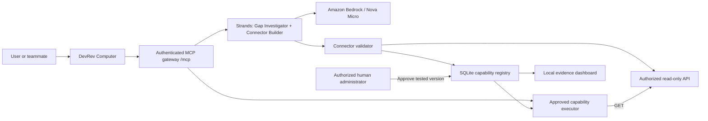

# ContextForge

**Active priority:** the read-only [Yahoo Finance MCP connector for DevRev Computer, hosted on the owner's Mac](FINANCE_MCP.md). The original six tools passed live Computer acceptance. Refinements add exact date ranges, multi-symbol history, CSV export, bounded retries/cache, and local diagnostics; all 69 offline tests and 23 real-provider checks pass. The running local server exposes 11 tools. Cloudflare independently expired the temporary tunnel; public transport and DevRev resync await approval to replace its URL. Further ContextForge product work and AWS deployment remain paused. Its configuration and approval records are preserved; its local server still responds, but its last remote Computer check failed with a separate transport error.

**Turn missing enterprise context into tested, reusable MCP capabilities.**

ContextForge is a Hack Midwest project that uses AWS Strands agents and Amazon Bedrock to identify a missing data capability, generate a restricted connector configuration, validate it against an authorized API, and make it reusable through DevRev Computer after human approval.

The product goal is automated, project-aware context discovery: a user asks a question, agents discover the missing connection, and an approved capability makes the question answerable. The current MVP proves one complete workflow using clearly labeled synthetic support tickets and engineering issues.

## The problem

An assistant can understand a question and still lack the API capability needed to answer it. For example:

> Which engineering issue is linked to support ticket DEMO-101? Include its title and source references.

ContextForge investigates that gap, proposes a documented read-only API operation, and validates the resulting connector. Source authorization and connector activation are separate decisions: an agent may inspect an authorized source before a connector exists, while activation requires an explicitly authorized human administrator.

## How the workflow works

1. **Identify the gap.** The Gap Investigator checks the question, existing capabilities, and the approved source specification.
2. **Inspect the source.** A bounded tool call verifies access to the documented API operation. An unauthorized source produces `permission_block`.
3. **Generate a connector.** The Connector Builder produces a typed manifest containing an allowed GET operation, path, and output mapping.
4. **Validate it.** Deterministic checks make real API requests and reject forbidden access, mutation, undocumented paths, arbitrary hosts, and incorrect mappings.
5. **Approve activation.** A human administrator reviews the tested version and approves it through the local CLI. A passing validation report leaves a new connector inactive.
6. **Execute and reuse.** DevRev Computer calls the approved capability through the MCP gateway and receives the source response and references. Authorized teammates can reuse the same capability.

The MVP adds capabilities to one existing MCP gateway. Connector generation produces a restricted configuration; execution uses the shared backend and its permission checks.

## Architecture



The dashboard reads registry state and saved execution receipts. The model proposes configurations; the backend enforces source restrictions, validates manifests, and checks approval before execution.

The implementation uses Python 3.12, MCP, AWS Strands, Amazon Bedrock Nova Micro, Starlette, HTTPX, Pydantic, JSON Schema, and SQLite. The demo interface uses plain HTML, CSS, and JavaScript. Cloudflare Tunnel supplies the current public HTTPS transport.

## The single demo use case

All business records in this demo belong to **`SYNTHETIC_CONTEXTFORGE_DEMO_V1`**. They are invented, authorized test records. Organizer-approved Enterprise-Bench data is still pending.

The documented operation is:

```http
GET /tickets/{ticket_id}/engineering-issues
```

| Input | Validated result |
| --- | --- |
| `DEMO-101` | `DEMO-ENG-201` — “Synthetic issue: normalize SAML audience after migration” |
| `DEMO-102` | `DEMO-ENG-202` — “Synthetic issue: paginate report export queries” |
| `DEMO-403` | Source HTTP 403; no business records or source references returned |

Successful results include references such as `synthetic://contextforge/tickets/DEMO-101` and `synthetic://contextforge/issues/DEMO-ENG-201`.

The generated, validated, and approved capability is **`get_ticket_engineering_issues_76f8fc748bff`**. Its manifest is:

```json
{
  "name": "get_ticket_engineering_issues",
  "purpose": "Retrieve engineering issues related to a specific support ticket",
  "operation_id": "get_ticket_engineering_issues",
  "method": "GET",
  "path_template": "/tickets/{ticket_id}/engineering-issues",
  "output_mapping": {
    "ticket_id": "ticket_id",
    "related_issues": "related_issues",
    "source_refs": "source_refs"
  }
}
```

For a three-minute demonstration, show the recorded gap investigation, generated manifest, ten validation checks, and human approval in the dashboard. Then execute `DEMO-101` live in Computer, show teammate reuse with `DEMO-102`, and demonstrate the `DEMO-403` denial. Identify saved generation and approval evidence as recorded steps. See the [demo runbook](MVP_WORKFLOW.md).

## Current validation status

| Component | Evidence and scope |
| --- | --- |
| MCP and DevRev connectivity | Authenticated discovery and tool calls passed through the existing HTTPS connection. |
| Bedrock and Strands | A real Nova Micro inference and a Strands Python tool call passed; the agent received the tool result. |
| Connector generation | Strands generated the manifest above; all ten connector validation checks passed. |
| Approval and execution | Human approval was recorded; live `DEMO-101` and `DEMO-102` requests returned correct references; `DEMO-403` remained denied. |
| Second-user reuse | A teammate confirmed their own Computer login; fresh execution receipts matched their `DEMO-102` success and `DEMO-403` denial. |
| Demo dashboard | Browser checks passed. It displays actual saved evidence and registry state. |
| Automatic capability selection | A missing-ID failure was fixed and passed 31 local checks. A live rerun of that fix is pending. |
| AWS hosting | Fourteen AWS preflight checks and 47 local deployment-preparation checks passed. Provisioning approval and hosted validation are pending. |
| Enterprise-Bench | Public-schema handoff and an inactive source contract are prepared. Authorized records or an API are pending. |

Detailed results, receipts, failed attempts, and remaining limits are recorded in [VALIDATION.md](VALIDATION.md). Shared MCP authentication does not establish individual caller identity; the second-user login confirmation is user-attested.

## Run locally

Use Python 3.12 and an authenticated AWS profile with access to the selected Bedrock model. The tested configuration uses profile `contextforge`, region `us-east-2`, and inference profile `us.amazon.nova-micro-v1:0`.

For a fresh checkout, install the pinned backend and workflow dependencies from the repository root:

```zsh
cd contextforge_mcp_starter
python3.12 -m venv .venv
.venv/bin/python -m pip install -r requirements-workflow.txt
.venv/bin/python -m pip check
```

Keep services in separate terminals. The following service commands start from the repository root; keep an existing working service running when using the current demo.

**Terminal 1 — synthetic API:**

```zsh
cd contextforge_mcp_starter
source demo/env.zsh
.venv/bin/python synthetic_source.py
```

**Terminal 2 — authenticated MCP server:** enter the existing server token privately when preserving a configured DevRev connection.

```zsh
cd contextforge_mcp_starter
source demo/env.zsh
read -rs 'MCP_TOKEN?MCP token (hidden): '
export MCP_TOKEN
export CONTEXTFORGE_ENABLE_WORKFLOW=1
.venv/bin/python server.py
```

**Terminal 3 — evidence dashboard:**

```zsh
cd contextforge_mcp_starter
source demo/env.zsh
.venv/bin/python demo_view.py
```

| Service | Local URL |
| --- | --- |
| MCP gateway | `http://127.0.0.1:8000/mcp` |
| Synthetic API | `http://127.0.0.1:8001` |
| Evidence dashboard | `http://127.0.0.1:8002` |

To verify AWS readiness from another terminal:

```zsh
cd contextforge_mcp_starter
source demo/env.zsh
.venv/bin/python strands_workflow.py check-bedrock --profile contextforge --region us-east-2
```

This command performs real inference and a bounded Strands tool call. It writes an execution receipt; model usage is billed by AWS. See the [backend guide](contextforge_mcp_starter/README.md) for configuration, troubleshooting, and the full proposal workflow.

## Use through DevRev Computer

Connect the public HTTPS endpoint ending in `/mcp` under **Settings → My Computer → Connectors**. In the PAT field, enter the MCP server's `MCP_TOKEN` privately, without the `Bearer` prefix. Each authorized teammate connects from their own Computer account.

The HTTP request uses `Authorization: Bearer <token>`. The gateway exposes these tools; Computer may display their names as Ping, InspectDemoCapability, ListCapabilities, ProposeConnector, and RunCapability.

| MCP tool | Purpose |
| --- | --- |
| `ping` | Confirm reachability. |
| `inspect_demo_capability` | Inspect the original connectivity probe. |
| `list_capabilities` | List configured capabilities and approval status. |
| `propose_connector` | Investigate a question, generate a manifest, and validate it. |
| `run_capability` | Execute an approved capability against the source. |

The last three tools require `CONTEXTFORGE_ENABLE_WORKFLOW=1`. Connector approval stays in the human CLI.

Example `RunCapability` arguments for the approved demo:

```json
{
  "capability_id": "get_ticket_engineering_issues_76f8fc748bff",
  "inputs": {"ticket_id": "DEMO-101"}
}
```

The tool reports a forbidden source request in its result as `status: forbidden` and `http_status: 403`; the MCP transport can still return HTTP 200. Follow [DEVREV_REUSE.md](DEVREV_REUSE.md) for teammate access and reuse testing.

## Approval and safety boundaries

- **Mandatory authentication:** startup requires `MCP_TOKEN`. Pure ASGI middleware rejects missing or incorrect bearer tokens with HTTP 401 and compares tokens in constant time.
- **Explicit source authorization:** the approved API contract and allowed-host configuration define inspection scope. The synthetic contract explicitly authorizes read-only inspection.
- **Restricted execution:** manifests permit documented GET operations and validated mappings. URL, path, response-size, schema, and source-reference checks constrain execution.
- **Human activation:** the local OS administrator policy and interactive confirmation authorize approval. Approval binds the connector version, source specification, and passing validation report. Agents and MCP clients cannot approve connectors.
- **Credential handling:** tokens, AWS credentials, private policies, databases, and execution receipts stay outside Git. The dashboard and synthetic API listen on loopback.

A fresh checkout starts without the private capability registry or previous approvals. After starting the synthetic API and configuring AWS, generate and validate a connector through `ProposeConnector` or the CLI:

```zsh
.venv/bin/python strands_workflow.py propose \
  --question "Which engineering issue is linked to support ticket DEMO-101? Include its title and source references." \
  --ticket-id DEMO-101 --profile contextforge --region us-east-2
```

For a newly validated connector, the authorized administrator initializes their private approval policy once and approves the returned ID. Replace `GENERATED_CAPABILITY_ID` below with that ID:

```zsh
.venv/bin/python strands_workflow.py init-admin
.venv/bin/python strands_workflow.py approve GENERATED_CAPABILITY_ID
```

Run these from `contextforge_mcp_starter`, review the displayed evidence, and complete the interactive confirmation. Existing approved capabilities can be reused directly. Shared bearer access currently authorizes the common synthetic source scope; per-user enterprise authorization remains future work.

## AWS deployment

The MCP server currently runs locally behind Cloudflare Tunnel. Bedrock inference already runs on AWS.

The prepared hosting plan moves the MCP gateway, synthetic API, and Strands workflow to one EC2 instance, with a temporary Cloudflare HTTPS tunnel running on that instance. It uses an instance role, preserves the original approval ledger in an archive, and requires real revalidation and explicit human approval of the staged connector. The local connection remains available during verification.

Billable infrastructure provisioning awaits approval. An AWS-hosted MCP URL has not been produced. See [deploy/README.md](deploy/README.md) for the resource proposal, packaging, installation, validation, and rollback instructions. Akamai was an initial hosting target; AWS is the selected deployment path while Akamai is unavailable.

## Repository structure

```text
contextforge_mcp_starter/
  server.py                  Authenticated MCP gateway
  strands_workflow.py        Gap investigation and connector generation
  aws_model.py               Bedrock configuration and readiness checks
  capability_runtime.py      Validation, registry, and capability execution
  connectors.py              Approved API adapter and manifest restrictions
  approval.py                Human administrator policy and approval
  synthetic_source.py        Read-only synthetic test API
  demo/                      API specification, records, and validation cases
  demo_view.py, demo_ui/      Read-only evidence dashboard
  enterprise_bench/          Inactive contract for future approved data
deploy/                      EC2 packaging, policies, and service templates
tasks/                       Product plan, ordered work, and checkpoints
validation_logs/             Private execution receipts; Git-ignored
```

## Next milestones and contributing

The next milestones are a stable AWS deployment, a live rerun of automatic capability selection, authorized Enterprise-Bench integration, and the planned web workspace. Keep the demonstration focused on the single tested connector and preserve its approval and permission boundaries.

Use the pinned dependencies, run checks appropriate to each change, and record actual PASS/FAIL evidence in [VALIDATION.md](VALIDATION.md). Update [TODO.md](TODO.md) at each checkpoint. Keep the original connectivity tools working and keep credentials out of commits.

| Guide | What it covers |
| --- | --- |
| [PROJECT_PLAN.md](PROJECT_PLAN.md) | Product scope, architecture, and current proof |
| [tasks/plan.md](tasks/plan.md) | Detailed web workspace and demonstration plan |
| [tasks/todo.md](tasks/todo.md) | Ordered implementation tasks |
| [MVP_WORKFLOW.md](MVP_WORKFLOW.md) | Live demonstration and validation runbook |
| [ENTERPRISE_BENCH_HANDOFF.md](ENTERPRISE_BENCH_HANDOFF.md) | Public-schema preparation and authorized-data prerequisites |
| [AGENTS.md](AGENTS.md) | Repository contributor guidelines |
| [tasks/checkpoints.md](tasks/checkpoints.md) | Checkpoint, commit, and push practices |
