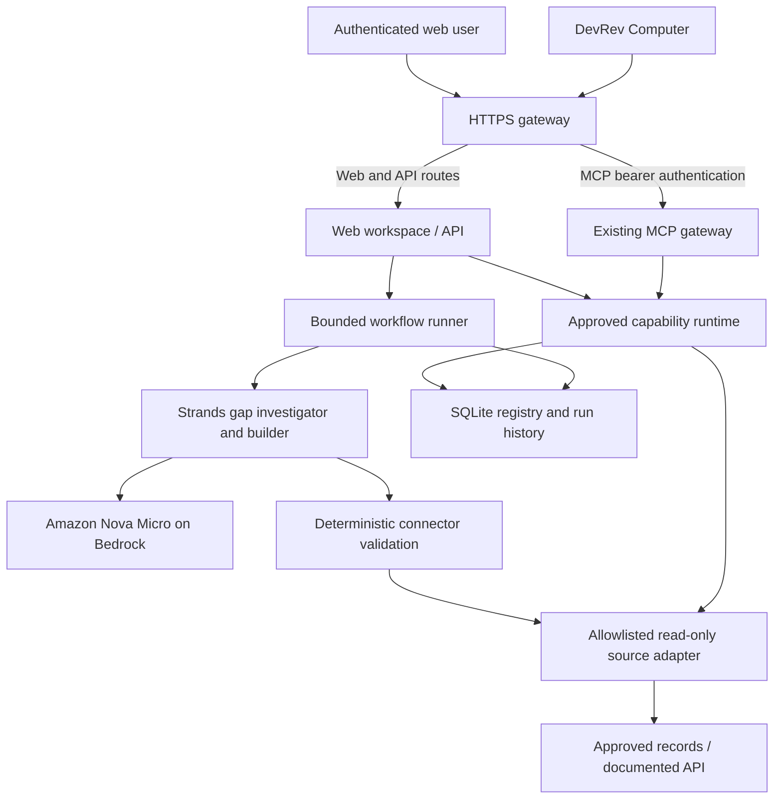

# ContextForge Product Plan — v0.1

**Status:** Planning. Web workspace is not implemented or deployed.\
**Decision:** Web workspace first; DevRev Computer demonstrates reuse.\
**Team:** Three builders. **Implementation checklist:** [tasks/todo.md](todo.md).\
**Verified foundation:** Authenticated MCP, user-confirmed DevRev calls, and an executed Nova Micro → Strands → tool → observed result cycle. See [VALIDATION.md](../VALIDATION.md).

## 1. What the user gets

ContextForge helps an integration owner recover a question that existing approved tools cannot answer. The user asks a question, sees the missing capability, reviews an AI-proposed connector and measured checks, approves the exact configuration, and receives an answer with sources. Another teammate can then use that capability in DevRev Computer.

The first release supports **one approved read-only source and one relationship lookup**. A ticket-to-engineering-issue question is the candidate scenario; it becomes the demo scenario only after actual approved records support that relationship. This is a constrained inventory demonstration, not a claim that DevRev lacks ticket tools.

### Access points

| Entry point | User | Purpose |
|---|---|---|
| Private HTTPS web workspace | Integration owner / demo operator | Ask, investigate, validate, approve, and view the recovered answer |
| Existing DevRev Computer connector | Authorized teammate | Discover approved capability IDs and run the same capability with another input |
| Backend CLI | Administrator | Configure approved sources, inspect state, disable a capability, and recover from failures |

Users receive an **actual deployed web URL after hosting is approved and validated**. No hostname has been provisioned. Judges initially use the team's authenticated browser; public registration is outside the MVP. CLI is an administrative fallback, not the main demo interface.

## 2. The first user journey

1. Open the workspace and authenticate.
2. Choose the configured source and an approved ticket; enter the enterprise question.
3. Click **Check available data**. The backend attempts the task using the current approved inventory and saves the real blocked or successful result.
4. If an existing capability works, show the answer immediately. If access is denied or the contract cannot support the question, explain the blocker without generating an adapter.
5. When an approved API operation can fill the gap, Strands proposes a restricted GET configuration and invokes the deterministic validator.
6. Show the proposed capability's purpose, source, inputs, permissions, and observed validation results. Failed checks prevent approval; allow at most one model repair.
7. An authorized person selects **Approve this capability**. Approval binds to the reviewed manifest version, source configuration, and passing validation report.
8. Rerun the original question through the approved capability. Display the changed outcome and supporting record references.
9. Show a capability ID and a copyable instruction for DevRev. A second teammate uses a different approved ticket in Computer and receives different, correct evidence.

The model cannot approve its own connector. A connection badge, generated JSON, or a model-written PASS does not complete this journey.

## 3. Web workspace design

Build one page with three connected panels. Avoid a dashboard full of unrelated metrics.

### Question panel

- Plain-language task input, maximum 2,000 characters, plus a required approved record identifier.
- Source selected from administrator-configured sources; no arbitrary URL entry.
- Current approved capabilities and the original task result remain visible.
- Submit once, disable duplicate submissions, and show real backend progress.

### Capability review panel

- Explain the gap: missing operation, permission problem, incorrect mapping, or unsupported question.
- Show the proposed capability's purpose, source, accepted input, and **read-only** permission.
- Display individual measured checks, their timestamp, and a concise failure explanation. Technical configuration can be expanded for inspection.
- Approval is visible only to an authorized approver and enabled only after backend-confirmed success. The server enforces this even if someone edits the page.
- For permission failures, show **Access required**; never offer connector generation as a permission bypass.

### Answer and reuse panel

- Keep **Before: blocked** and **After: answered** together.
- Render the narrow answer from verified tool fields; use a template for this first scenario so an extra model cannot invent relationships.
- Show source IDs, dataset label, retrieval time, and the capability version used.
- Offer a different-record retry and a copyable DevRev instruction. Do not invent a DevRev deep link or automatic connector registration.

### Failure behavior

| Backend condition | User experience |
|---|---|
| Missing source configuration | Explain what the administrator must configure; no fabricated answer |
| Source returns 403 or 404 | Access required or record not found |
| Validation fails | Show observed failure; approval remains unavailable |
| Bedrock is unavailable or run budget ends | Explain that investigation did not complete; manual retry |
| Capability is disabled or source changes | Withhold execution until retested and approved |
| Worker restarts mid-run | Mark the run interrupted; never silently repeat paid model calls |

Use readable text, keyboard-accessible controls, clear focus, and status text alongside color. All visible results come from backend responses. No animated demonstration may stand in for execution.

## 4. Architecture and technology choices

Use Python throughout: **FastAPI + Jinja templates + small vanilla JavaScript** for the workspace, the existing MCP SDK for Computer, Strands for inference, HTTPX/Pydantic/JSON Schema for restricted execution, and SQLite for state. This keeps one codebase and avoids a separate frontend build service. FastAPI supports server-rendered templates through its documented [Jinja integration](https://fastapi.tiangolo.com/advanced/templates/).



Web and MCP call the **same runtime**, so approval and disablement affect both. The web browser never receives `MCP_TOKEN` or AWS credentials. Keep the MCP transport and pure ASGI authentication intact; do not route MCP through middleware that buffers streams.

### Strands responsibilities and limits

- **Gap investigator:** Choose reuse, permission block, mapping issue, new read-only adapter, or unsupported task using the actual inventory and approved contract.
- **Connector builder:** Generate a typed operation/mapping configuration and call the measured validator. It receives real failure feedback and may repair once.
- **Validator:** Determines results independently of the model. It remains product code after removal of standalone test scripts.
- Start with the actually tested profile `us.amazon.nova-micro-v1:0` from `us-east-2`. This is a US cross-Region inference profile, not proof that direct single-Region invocation works. [AWS inference-profile documentation](https://docs.aws.amazon.com/bedrock/latest/userguide/inference-profiles-support.html) describes the routing behavior; approved data handling must account for it.
- Retain bounded calls: gap agent two turns; builder four turns; at most three validator calls; one repair; 180-second workflow deadline. Record actual usage and never automatically switch to a more expensive model.

### Data and connector boundaries

The administrator supplies the source URL, host allowlist, contract, validation record IDs, and any source credentials. Generated manifests contain no code, credentials, hosts, or new permissions. Accept only documented GET operations, validate parameters and output, reject redirects, and cap requests at five seconds / 64 KiB.

Preserve dataset labels and source references. No Enterprise-Bench path or record has been confirmed. The synthetic mock API and its records have been removed at the user's request; the business demo therefore needs an approved source before it can answer an enterprise question.

## 5. Access control

For the three-person demo, use an authenticated HTTPS gateway with individual team identities. Caddy's documented [basic_auth](https://caddyserver.com/docs/caddyfile/directives/basic_auth) supports hashed passwords and an authenticated username. This is the narrow MVP option; enterprise SSO and multiple organizations come later.

- Protect the workspace, API, and result history. Keep `/mcp` on its existing bearer scheme; a browser-login challenge must not replace DevRev's bearer authentication.
- Trust identity only from the configured gateway, strip incoming identity headers, and bind application ports to loopback.
- Map authenticated identities to operator/approver roles in server configuration. Operator may start generation; approver may activate a tested version. Roles can overlap for the demo, but approval is always an explicit human action.
- State-changing web requests require CSRF protection and origin checks. Escape source/model text before rendering; only approved HTTPS evidence links become clickable.
- Limit the MVP to one team workspace whose connected users share authorization to the approved source. The shared MCP PAT does not establish per-user record permissions; do not claim enterprise multitenancy or identity delegation.

Credentials are entered privately during setup, stored server-side, and excluded from source, UI, model prompts, and logs. Public signups, connector marketplaces, arbitrary OAuth, and production customer ingestion are deferred.

## 6. Backend interfaces and persistence

The HTTP routes are proposed. The MCP dispatcher functions exist as disabled backend groundwork and still need live Computer verification.

| Interface | Behavior |
|---|---|
| `POST /api/workflows` | Validate task/source input; save baseline; return `202` and a run ID |
| `GET /api/workflows/{id}` | Return authorized run status, proposal, measured checks, approval, and answer |
| `POST /api/capabilities/{id}/approve` | Verify approver, exact reviewed version/source/report, and passing checks |
| `POST /api/capabilities/{id}/run` | Execute only an approved capability; use the same runtime as MCP |
| `POST /api/capabilities/{id}/disable` | Revoke execution and record the authenticated actor |
| MCP `list_capabilities` / `run_capability` | Stable dispatcher tools for Computer; internal registry changes need no new tool name |

Start with one Strands job at a time and a small bounded queue. Poll run status approximately every two seconds rather than relying on streaming through the current tunnel. Store run ownership and verify it on reads; do not accept a client-supplied user ID as identity.

Persist manifests, validation reports, approvals, workflow runs, and append-only events. Bind a capability to a fingerprint of the source URL, contract, and host allowlist. Changing that fingerprint requires retesting and new approval. Keep the exact before/after input and measured result so the demo can be assessed later.

## 7. Main project organization

The following layout is **proposed**, not an existing application:

```text
contextforge/
  config.py, models.py       # explicit settings and typed contracts
  source.py, validation.py   # approved GET execution and measured checks
  registry.py, workflow.py   # versions, approval, bounded Strands jobs
  mcp_server.py, cli.py      # Computer gateway and administrative commands
  web.py, jobs.py            # authenticated routes and job lifecycle
  templates/, static/       # workspace HTML, CSS, small JavaScript
deploy/                     # reviewed HTTPS/service configuration
tasks/                      # this plan and implementation checklist
validation_logs/            # sanitized evidence, never credentials
```

Migrate retained modules incrementally. Keep `contextforge_mcp_starter/server.py` working as the compatibility entry point during the transition. Preserve `ping`, `inspect_demo_capability`, `/mcp`, port 8000, and authentication. The legacy inspection tool remains because the existing DevRev integration already uses it.

## 8. Deployment and cost control

AWS EC2 is the requested hosting target because Akamai is currently unavailable. **No instance, IAM role, domain, or account upgrade is authorized for creation yet.** Before provisioning, prepare a reviewable proposal listing region, instance size, disk, HTTPS approach, required role permissions, current prices, expected runtime, spending ceiling, and shutdown steps. Check Free Plan eligibility; credits are not permission to upgrade.

After approval, use one VM, one Python environment, SQLite on persistent disk, and supervised services. Keep MCP on loopback port 8000 and the web service on a separate loopback port. Use an approved HTTPS hostname/gateway; no load balancer, RDS, Kubernetes, or separate queue service is needed for this MVP.

AWS calls use an approved role or existing authenticated profile, without permanent keys in the repository. Only CloudShell inference is proven today; local worker credentials and an EC2 role are not configured. Keep the current Cloudflare/DevRev endpoint alive until its replacement passes actual remote MCP and Computer calls. Verify state survives restart before changing the connector URL.

## 9. Three-minute live demonstration

Prerequisites: approved source supports the question; real model-driven generation and validation work; authenticated web and Computer access work; a second teammate is ready. Select two different real approved record IDs during rehearsal. Do not invent example IDs or label a replay as live.

| Time | Action | Evidence judges see |
|---|---|---|
| 0:00–0:20 | Introduce the question and current inventory | A recorded blocked result; required lookup is unavailable |
| 0:20–0:55 | Start investigation in the web workspace | Strands identifies the gap and proposes an allowed read-only capability |
| 0:55–1:25 | Show measured validation | Actual known/missing/forbidden/mapping checks; source references |
| 1:25–1:45 | Review and approve the exact candidate | Human approval, permissions, capability version |
| 1:45–2:10 | Rerun the original question | Correct before/after answer with references |
| 2:10–2:45 | Second teammate asks Computer about the second record | Same capability ID, different result, correct evidence |
| 2:45–3:00 | Explain value and current limits | Missing context became an approved reusable capability |

Rehearse latency before committing to this schedule. If generation is too slow, reduce prompt size/agent turns and cut narration. A previously generated capability may demonstrate reuse, but that segment must be described as reuse rather than live generation. If AWS or source access fails, display the actual blocker and optionally a clearly labeled saved receipt.

Use a fresh demonstration workspace or unique task/version; do not delete audit history to manufacture an empty inventory. Keep a separately approved reusable capability available as a fallback, clearly identified.

## 10. Build order and team ownership

1. **Backend owner:** Package the working modules and obtain an approved source/validation contract.
2. **Backend + AI owners:** Persist versions/approval/history; execute one real Strands-generated proposal with measured validation and a recovered answer.
3. **DevRev owner:** Enable stable dispatcher tools, resync once, and verify two authorized records in Computer.
4. **Backend + web owner:** Add authenticated web routes, bounded job state, then the one-page workspace.
5. **All:** Review AWS deployment resources; provision only after explicit approval; migrate and rehearse the live story.

The detailed tasks have acceptance criteria, dependencies, verification, and file scope in [tasks/todo.md](todo.md). Backend correctness precedes frontend implementation. Different people can work on the source and agent prompts after agreeing on typed interfaces; schema and deployment changes remain sequential.

### Release gates

- The first source and its relationship are approved and actually queried.
- A real Strands run generates a configuration and invokes its validator; compatibility arithmetic alone does not satisfy this gate.
- Unapproved/disabled capabilities and unauthorized web/MCP requests are rejected.
- The original question becomes answerable through the approved runtime.
- The web workspace displays actual state; a second teammate reuses the capability in Computer.
- AWS migration is approved, tested, restart-safe, and within the agreed budget.

## 11. Decisions still needed

| Decision | Owner | Needed before |
|---|---|---|
| Confirmed approved records/API and two meaningful input IDs | Team / organizer | Business connector validation |
| Supported question and source contract | Backend + DevRev owners | Final connector behavior and demo text |
| Existing AWS profile or approved runtime role | Account owner | Live model calls from the application worker |
| Web identities and approver roles | Team administrator | Hosted web access |
| AWS resource budget, instance eligibility, HTTPS hostname | Account owner | Provisioning |
| New dispatcher discovery and second-user permissions | DevRev owner | Reuse demonstration |
| Sponsor acceptance of AWS fallback and approved evidence | Team / sponsors | Track eligibility claims |

Planning and source-independent implementation can proceed while these are resolved. A missing prerequisite must remain visible; it cannot be filled with fabricated data or a claimed PASS.

## 12. Path from demo to a broader product

After the complete narrow workflow is proven, replace the demo access gate with organization login, workspace isolation, and auditable role management. Confirm how DevRev user identity and source permissions can be carried through MCP before supporting different users with different data access. Add a second documented source only after the first connector lifecycle is reliable. Introduce managed persistence or separate workers when measured concurrency requires them. These are future product stages, not requirements for the three-person hackathon build.
